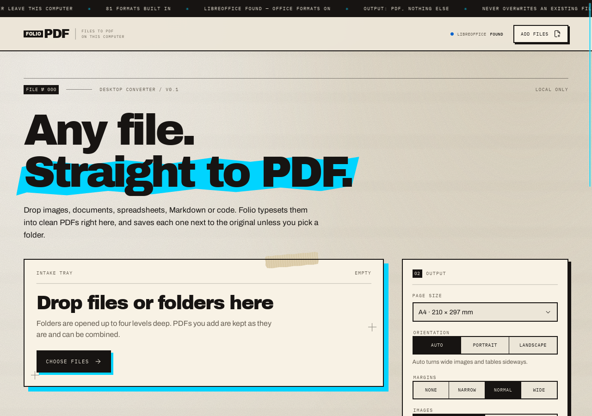
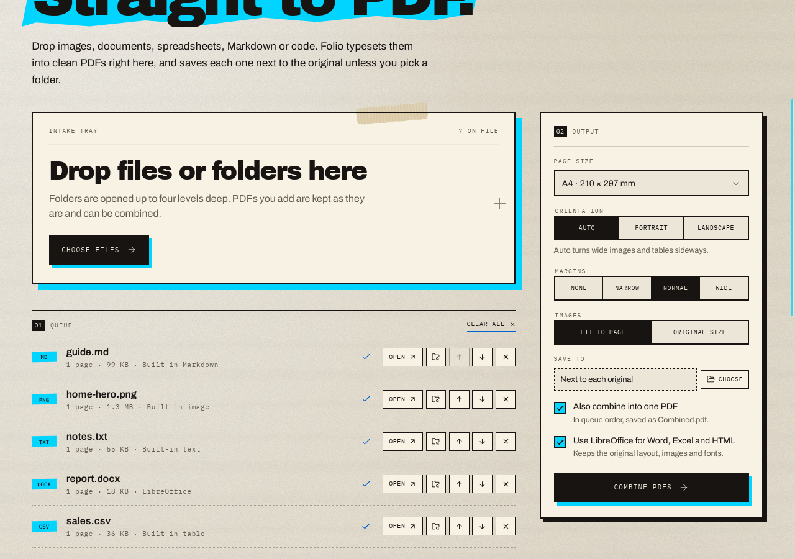

# Folio desktop

A Tauri 2 app that converts files to PDF on your own computer. Nothing is uploaded. The interface follows the EU JUST look: paper and ink, neon blue markers, offset shadows and mono labels.





## What it converts

| Input | Engine | Notes |
| --- | --- | --- |
| PNG, JPEG, WebP, GIF, BMP, TIFF, ICO, TGA, QOI, PNM | Built in | One page per image. JPEGs are embedded without re-encoding. Transparency becomes white. Fit to page or keep original size. |
| TXT, logs, JSON, XML, YAML, TOML and source code | Built in | Monospace, so indents and columns stay put. Unknown extensions are tried as text when they look like UTF-8. |
| Markdown | Built in | Headings, emphasis, lists, quotes, code blocks and tables. |
| HTML | LibreOffice, or built in | Built in keeps the readable text. |
| CSV, TSV | Built in | Framed tables, landscape on Auto when there are many columns. |
| XLSX, XLS, XLSM, ODS | LibreOffice, or built in | Built in prints one table per sheet. |
| DOCX | LibreOffice, or built in | Built in keeps text, headings, bold/italic, lists and tables. |
| DOC, ODT, RTF, PPT, PPTX, ODP, ODG, Pages, Keynote, Numbers, SVG, VSDX | LibreOffice only | Shown as off in the app until LibreOffice is installed. |
| PDF | — | Kept as is, and can be combined with the others. |

Other features: drop files or whole folders, choose page size (A4, Letter, Legal, A3, A5), orientation and margins, save next to each original or into one folder, combine everything into `Combined.pdf` in queue order, and open or reveal each result. Existing files are never overwritten (`name (2).pdf`).

Text-based PDFs embed only the glyphs they use from the bundled fonts (Liberation Sans and JetBrains Mono, both SIL OFL), so a one-page document is about 40 KB.

LibreOffice is optional. Folio looks for it on `PATH` and in the default install folders on macOS, Windows and Linux. Set `FOLIO_SOFFICE` to point at a different `soffice`. Each conversion uses a throwaway LibreOffice profile with macros disabled.

## Build it

You need Node.js 22.12+, Rust 1.77+ and the [Tauri 2 system prerequisites](https://v2.tauri.app/start/prerequisites/):

- **macOS:** Xcode Command Line Tools (`xcode-select --install`).
- **Windows:** Microsoft C++ Build Tools and WebView2 (preinstalled on Windows 10/11).
- **Debian/Ubuntu:** `sudo apt install libwebkit2gtk-4.1-dev libgtk-3-dev librsvg2-dev libayatana-appindicator3-dev libssl-dev build-essential pkg-config`

Then, from this folder:

```sh
npm install          # JS dependencies, including the Tauri CLI
npm run app:dev      # run the app with live reload
npm run app:build    # build installers into src-tauri/target/release/bundle/
npm test             # Rust conversion tests
```

All Rust crates are declared in `src-tauri/Cargo.toml` and fetched by Cargo on the first build. Fonts and icons are in the repository, so the build needs nothing else.

The GitHub Actions workflow `.github/workflows/desktop.yml` checks every pull request that touches `desktop/` on Linux. Run it manually (Actions → Desktop app → Run workflow) to build installers for macOS, Windows and Linux; they are attached to the run as artifacts.

## Layout

```
desktop/
  src/                 React interface (Vite)
  src-tauri/
    src/lib.rs         Tauri commands: engine_status, expand_paths, convert_file, merge_pdfs
    src/convert/       image_pdf, text (Markdown, HTML, tables), docx, office (LibreOffice), merge, slim (font subsetting)
    fonts/             Bundled PDF fonts
    icons/             App icons
```

This app is separate from the web converter at the repository root. It has its own `package.json` and is not part of the Railway build.
